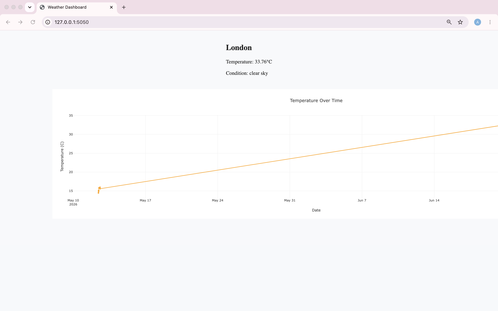
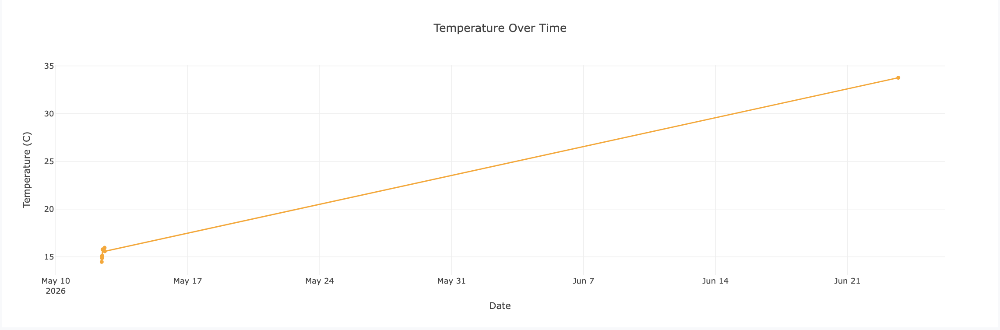
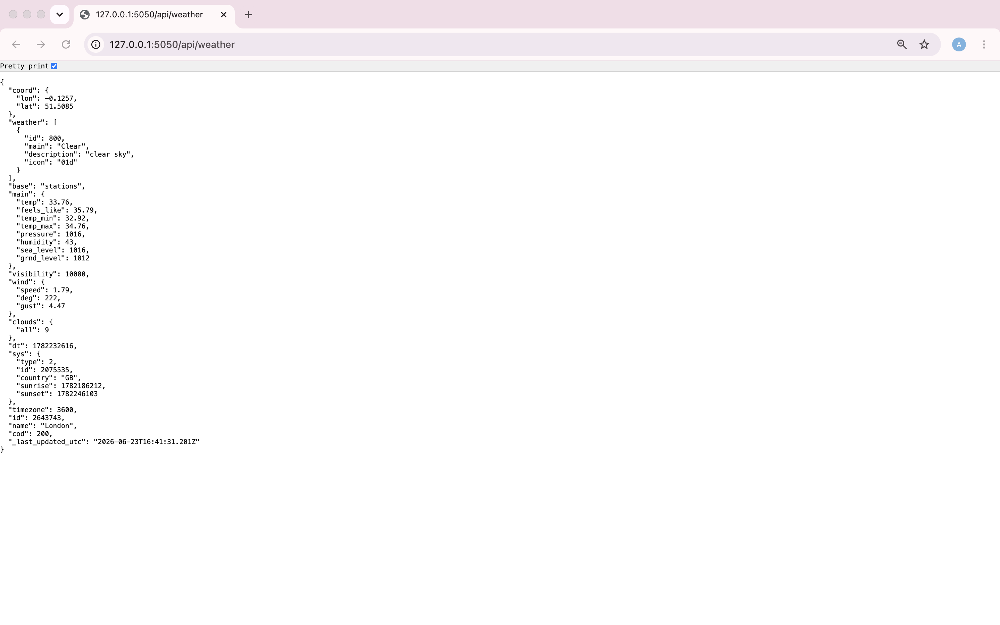
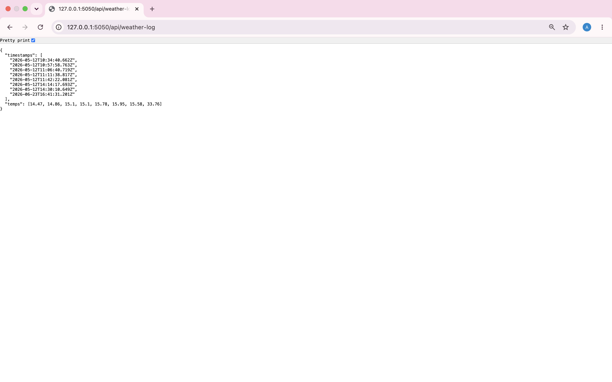

# Weather DataOps Pipeline

A JavaScript DataOps project that collects live weather data on a schedule, stores it, tests it, packages it in Docker and deploys it, with a web dashboard to explore the results.

## Overview

The application retrieves current weather data from the OpenWeather API, saves the latest reading as JSON, appends each reading to a CSV history, and shows trends on an interactive dashboard. A GitHub Actions workflow runs the collection on a schedule and triggers deployment to Render.

I built this at La Fosse Academy to practise data pipeline automation, API integration, testing, containerisation and continuous delivery.

## At a glance

As of 14 October 2026, the workflow had run 1,108 times since 12 May 2026, with 1,104 successful runs (99.6%) and 4 failures.

| Metric | Result |
| - | -: |
| Workflow runs | 1,108 |
| Successful runs | 1,104 |
| Scheduled runs | 1,096 |
| Push-triggered runs | 11 |
| Manually triggered runs | 1 |
| Jest tests | 3 passing |
| History CSV | 823 lines (822 data rows and a header) |
| Docker image | 82.8 MB content, 343 MB disk usage |
| Docker build with no cache | About 7.8 seconds |

The schedule is set to every two hours (`0 */2 * * *`). GitHub can delay scheduled workflows during busy periods, so runs do not always start exactly on the hour.

## Technologies

### Backend

- JavaScript (Node.js 22)
- Express

### Data

- OpenWeather API
- JSON
- CSV

### Testing

- Jest

### Visualisation

- Plotly.js

### DevOps and deployment

- Docker
- GitHub Actions
- Render

## Key features

- Scheduled weather data ingestion from the OpenWeather API
- Latest reading stored as JSON
- Historical readings appended to a CSV log
- REST endpoints for current and historical data
- Interactive dashboard with a Plotly temperature trend chart
- Jest tests that check the data files
- Docker image with a lean build context
- GitHub Actions workflow that collects data, tests it and triggers deployment

## Architecture

```text
OpenWeather API
        │
        ▼
  fetchWeather.js
        │
        ├── weather.json
        └── weather_log.csv
                │
                ▼
          Express API
                │
     ┌──────────┴──────────┐
     ▼                     ▼
/api/weather        /api/weather-log
     │                     │
     └──────────┬──────────┘
                ▼
        Frontend dashboard
                │
                ▼
          Plotly charts
```

## My contribution

I implemented and connected the pipeline end to end:

- Integrating the OpenWeather API
- Collecting and transforming data into JSON and CSV
- Building the Express API
- Building the dashboard and Plotly chart
- Writing the Jest tests
- Containerising the application with Docker and tightening the build
- Configuring the GitHub Actions workflow and the Render deployment

## Screenshots

### Dashboard overview



### Temperature trend visualisation



### Current weather API endpoint



### Historical weather log endpoint



## CI/CD pipeline

The GitHub Actions workflow runs on a two-hourly schedule, on pushes and on manual dispatch. Each run:

1. Installs dependencies
2. Retrieves the latest weather data
3. Updates the JSON and CSV files
4. Runs the Jest tests
5. Commits the updated data files
6. Triggers deployment to Render

Collection, testing, version control and deployment all run without manual steps.

Four runs in the history failed. One was GitHub failing to allocate a hosted runner. Two failed at the Render deployment step with a non-zero exit, and one was reported by GitHub as a workflow file issue.

## Testing

There are 3 Jest tests, all passing. They check that:

- `weather.json` exists
- `weather.json` contains the required keys
- the CSV log exists and has a header row

They are checks on the data files and do not exercise the application code, so I do not quote a coverage figure.

```bash
npm test
```

## Running locally

Install dependencies:

```bash
npm install
```

Create a `.env` file:

```env
WEATHER_API_KEY=your_api_key
CITY=London
```

Fetch the latest weather data, then start the application:

```bash
node fetchWeather.js
node app.js
```

Open the dashboard at:

```text
http://localhost:5000
```

## Docker

Build the image:

```bash
docker build -t weather-pipeline .
```

Run the container:

```bash
docker run -p 5001:5000 weather-pipeline
```

Open the dashboard at `http://localhost:5001`. The mapping connects port 5001 on the host to port 5000 inside the container, which is where the application listens (`ENV PORT=5000` in the Dockerfile). Port 5001 is used on the host because macOS can hold port 5000 for another service. The image serves the data files committed to the repository.

I tightened the Docker build after measuring the first version:

| Measure | Before | After |
| - | -: | -: |
| Content size | 108 MB | 82.8 MB |
| Disk usage | 496 MB | 343 MB |
| Build with no cache | 22.5 seconds | 7.8 seconds |

The changes were a `.dockerignore` file that keeps `node_modules`, `coverage`, `.git`, `.github`, `.env` and Markdown files out of the build context, copying `package*.json` to the working directory instead of the filesystem root, and installing production dependencies only. Keeping `.env` out of the image also stops local secrets being baked in.

## What I learned

- Building a scheduled data pipeline with GitHub Actions
- Integrating an external API and storing the results in JSON and CSV
- Reading workflow logs to work out why a run failed
- Writing tests for data files, and knowing what such tests do not cover
- Keeping Docker build contexts small and installing only what the image needs
- Keeping secrets out of images and repositories
- Deploying automatically to Render

## Future improvements

- Support several cities
- Store history in a database
- Add tests for the API and the fetch script
- Add alerts for extreme weather
- Add data quality monitoring
- Add dashboard filters and summary statistics

## Repository structure

```text
Weather-DataOps-Pipeline/
├── .github/workflows/
├── data/
│   ├── weather.json
│   └── weather_log.csv
├── public/
│   ├── client.js
│   ├── index.html
│   └── style.css
├── screenshots/
│   ├── dashboard-overview.png
│   ├── temperature-chart.png
│   ├── api-weather-endpoint.png
│   └── api-weather-log.png
├── tests/
│   └── weather.spec.js
├── .dockerignore
├── app.js
├── fetchWeather.js
├── Dockerfile
├── package.json
└── README.md
```
